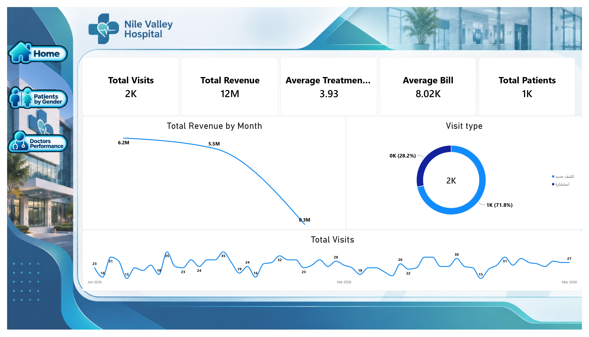
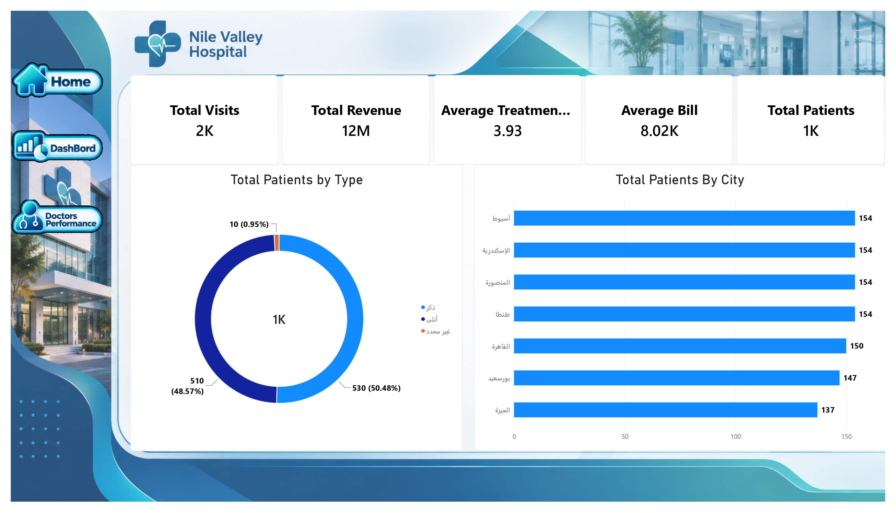
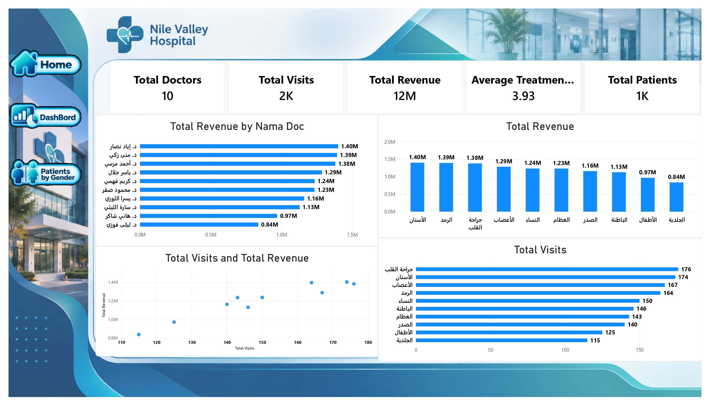

# 🏥 Hospital Performance Analytics

A Power BI project focused on analyzing hospital visits, revenue, patients, doctors, and medical departments.

## 🎯 Project Objective

The purpose of this project was to explore hospital operations and understand how visits, revenue, and patients are distributed across different periods, cities, doctors, and specialties.

## 🔧 What I Worked On

- Reviewed patient and visit information.
- Analyzed total visits and revenue.
- Compared revenue across months.
- Explored visit types.
- Analyzed patient distribution by gender.
- Compared patient counts across cities.
- Reviewed revenue generated by each doctor.
- Compared visits and revenue across medical specialties.

## 📊 Dashboard Pages

### 1. Hospital Overview

This page gives a summary of the main hospital metrics.

It includes:
- Total Visits
- Total Revenue
- Average Treatment
- Average Bill
- Total Patients
- Revenue by Month
- Visit Type
- Visits over Time

### 2. Patients Analysis

This page focuses on patient distribution.

It includes:
- Patients by Gender
- Patients by City
- Patient Count by Location

### 3. Doctors Performance

This page compares doctor and department performance.

It includes:
- Total Doctors
- Revenue by Doctor
- Revenue by Medical Specialty
- Visits by Specialty
- Relationship between Visits and Revenue

## 📌 Dashboard Highlights

| KPI | Result |
|---|---:|
| Total Visits | 2K |
| Total Revenue | 12M |
| Average Treatment | 3.93 |
| Average Bill | 8.02K |
| Total Patients | 1K |
| Total Doctors | 10 |

## 🛠️ Tool Used

- Microsoft Power BI

## 🔄 Workflow

Source Data → Data Review → Patient & Visit Analysis → Power BI Dashboard → Performance Reporting

## 📁 Project Files

- `Hospital.pbix` – Power BI report
- `screenshots/` – Dashboard screenshots

## 👨‍💻 Author

**Beshoy Medhat**

Data Analyst
